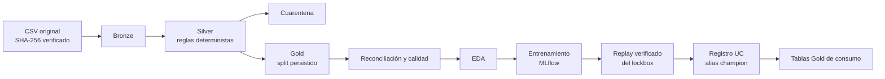

# Predicción de resistencias del cemento

Solución del **Reto 2 (GCC) del Datathon MICAI 2026**: predecir la resistencia a compresión del cemento a 1, 7 y 28 días (`Strength1`, `Strength7`, `Strength28`; R1, R7 y R28 en este documento) a partir de métricas físicas, fases minerales, composición química y tipo de producto, y explicar qué variables pesan en cada predicción.

Incluye un pipeline medallón reproducible en Databricks con Unity Catalog, entrenamiento y registro con MLflow, incertidumbre conformal y una evaluación única sobre datos reservados. El enunciado oficial está en [`docs/README.md`](docs/README.md) y la rúbrica en [`project_evaluation/`](project_evaluation/).

**Equipo:** Diego, Ricardo y Christopher.

## Estado

| Componente | Estado | Evidencia |
|---|---|---|
| Auditoría de datos y reglas de limpieza | Completo | [Fase 0](docs/fase0/data_audit.md), [ADR 0002](docs/adr/0002-hallazgos-f0-reglas-de-limpieza.md) |
| Medallón Bronze → Silver → Gold en Unity Catalog | Completo | [ADR 0003](docs/adr/0003-arquitectura-medallon-y-job.md), `notebooks/00`–`04` |
| EDA con interpretación física | Completo | [Fase 2](docs/fase2/eda.md) |
| Modelado con CV y MLflow | Completo | [Fase 3](docs/fase3/modelado.md) |
| Evaluación única del lockbox | Completa | [Fase 4](docs/fase4/lockbox.md) |
| Job de punta a punta en Databricks | Completo en modo `guided` | [Sección 5](#5-ejecución-en-databricks) |
| App de resultados y simulador | Disponible, con acceso por contraseña; se despliega con [`app/DEPLOY.md`](app/DEPLOY.md) | [`app/`](app/), [ADR 0010](docs/adr/0010-app-vercel-y-dashboard-minimo.md) |

## 1. Resultados

El modelo elegido es un **proceso gaussiano (GPR) con arquitectura (a)**: un modelo independiente por resistencia y una proyección isotónica no negativa que garantiza R1 ≤ R7 ≤ R28. Se eligió por CV sobre train, antes de abrir el test.

Desempeño en el **lockbox** (152 filas reservadas, evaluadas una sola vez). Los errores están en las unidades originales de resistencia, con IC 95% por bootstrap de grupos:

| Target | MAE [IC 95%] | MAPE % | R² | ΔMAE frente a L1 [IC 95%] |
|---|---:|---:|---:|---:|
| R1 | 96.2 [84.7, 108.3] | 4.34 | 0.905 | -64.1 [-84.1, -44.6] |
| R7 | 228.6 [198.3, 260.5] | 3.76 | 0.640 | -67.4 [-91.6, -43.3] |
| R28 | 280.8 [246.1, 317.3] | 3.77 | 0.569 | -127.3 [-175.6, -80.3] |

- **Comparación entre familias:** las tres (lineal, LightGBM y GPR) mejoran a L1 en las tres resistencias, con IC que excluye el cero. LightGBM obtiene un MAE puntual menor en R7 y R28 (218.5 y 269.1), con IC traslapados; el test no se usó para cambiar la selección.
- **Validación adversarial:** AUC 0.435, frente a un umbral de 0.6.
- **Incertidumbre:** los intervalos CV+ al 90% de GPR cubren entre 93.6% y 94.7% en test.
- **Referencia en CV:** GPR (a) con HPO anidada obtiene un MAE de 106.69, 259.65 y 307.51 en R1, R7 y R28 ([Etapa 3](docs/fase3/multisalida.md)).

Reporte completo: [`docs/fase4/lockbox.md`](docs/fase4/lockbox.md).

## 2. Límites del modelo

- **Deriva:** la CV temporal suma +48, +152 y +168 de MAE en R1, R7 y R28. El lockbox mide interpolación dentro del periodo, no desempeño futuro.
- **Tipos de producto:** Type 4 (n = 6) y Type 5 (n = 1) no tienen soporte, y la cobertura fuera de Type 1 no es fiable por el tamaño de muestra.
- **Explicaciones:** SHAP y la importancia por permutación describen asociaciones del modelo, no efectos causales. En R28 parte de la señal puede reflejar la deriva, por lo que no sirven por sí solas para recomendar cambios de formulación.
- **Variables anónimas:** los datos vienen escalados y sin unidades originales, y su interpretación física es una identificación razonada ([huella de variables](docs/fase0/variable_fingerprint.md)).

## 3. Arquitectura



| Capa | Contenido | Filas |
|---|---|---:|
| `datathon_data_bronze` | CSV crudo como texto, con linaje (`_row_id`, `_ingest_ts`, `_source_file`, `_file_hash`) | 791 |
| `datathon_data_silver` | Tipos y normalización determinista | 773 |
| `silver_quarantine` | Filas excluidas, cada una con su motivo | 18 |
| `datathon_data_gold` | Features, targets, indicadores y columna `split` | 773 (621 train, 152 test) |

El job publica además `gold_model_metrics`, `gold_predictions`, `gold_feature_importance` y `gold_train_ranges`, pensadas como fuente para el dashboard. El modelo queda registrado como `datathon.gcc.gcc_strength_champion@champion`.

## 4. Decisiones metodológicas

- **Sin fuga de targets:** ningún target se usa como feature, ni directa ni indirectamente.
- **Estadísticas dentro del `Pipeline`:** Silver solo hace transformaciones deterministas. Imputación y escalado se ajustan con train, dentro del `Pipeline` de sklearn.
- **Split por grupos:** los grupos de filas con el mismo trío de resistencias no se separan entre train y test. El split se persiste en Gold y su identidad queda fijada en `conf/lockbox.sha256`.
- **Selección solo con CV:** features, hiperparámetros y arquitectura se eligieron con CV sobre train. El test se evaluó una vez, al final, tras la validación adversarial.
- **Reproducibilidad:** `random_state=42` en splits, CV y modelos; dependencias fijadas a las versiones del entorno serverless; `ProductType` tratado siempre como categórico.

Las decisiones están documentadas en [`docs/adr/`](docs/adr/):

| ADR | Tema |
|---|---|
| [0001](docs/adr/0001-local-first-y-paridad-serverless.md) | Desarrollo local con paridad serverless |
| [0002](docs/adr/0002-hallazgos-f0-reglas-de-limpieza.md) | Reglas de limpieza y split |
| [0003](docs/adr/0003-arquitectura-medallon-y-job.md) | Arquitectura del medallón y del job |
| [0004](docs/adr/0004-dependencias-f1-y-empaquetado.md) | Dependencias y empaquetado |
| [0005](docs/adr/0005-features-fisicas-y-preprocesamiento.md) | Features físicas y preprocesamiento |
| [0006](docs/adr/0006-protocolo-cv-y-seleccion.md) | Protocolo de CV y selección |
| [0007](docs/adr/0007-arquitectura-multisalida-e-incertidumbre.md) | Arquitectura multisalida e incertidumbre |
| [0008](docs/adr/0008-protocolo-lockbox.md) | Protocolo del lockbox |
| [0009](docs/adr/0009-entrenamiento-y-registro-en-databricks.md) | Entrenamiento y registro en Databricks |
| [0010](docs/adr/0010-app-vercel-y-dashboard-minimo.md) | App de resultados y dashboard |

## 5. Ejecución en Databricks

Guía completa: [`docs/databricks_runbook.md`](docs/databricks_runbook.md). Requiere Databricks CLI autenticado con un perfil propio. Los targets del bundle son `diego`, `ricardo` y `christopher`.

```bash
databricks bundle validate -t <target> -p <perfil>
```

```bash
databricks bundle deploy -t <target> -p <perfil>
```

```bash
databricks bundle run gcc_end_to_end -t <target> -p <perfil>
```

El parámetro `train_mode` admite tres modos:

| Modo | Qué hace | Requisito |
|---|---|---|
| `guided` (por defecto) | Reutiliza diagnósticos completos calculados en local, verificados por hash, y hace en Databricks el ajuste final, el replay, el registro y la publicación | Carpeta privada `data/training_evidence/` |
| `full` | Recalcula también todos los diagnósticos (no se ha ejecutado aún en Databricks) | Ninguno; consume más cuota |
| `quick` | Calcula diagnósticos reducidos para pruebas técnicas | Ninguno |

`guided` no repite la CV dentro de Databricks: las tablas y el modelo registran el origen local de los diagnósticos (`diagnostics_origin`, `diagnostics_source_run_id`). El paquete de evidencia contiene resultados de train, no se versiona y se comparte por un canal privado.

**Corrida verificada:** run `937701051902203` en modo `guided`, terminado con éxito en 801 s, con las 10 tareas al primer intento y replay aprobado. El tiempo puede variar según la cuenta.

| Tarea | Duración (s) |
|---|---:|
| `bootstrap` | 30 |
| `bronze` | 47 |
| `silver` | 80 |
| `gold` | 51 |
| `reconcile` | 28 |
| `eda` | 59 |
| `train` | 151 |
| `evaluate` | 193 |
| `register` | 62 |
| `publish` | 95 |

## 6. Ejecución local

Requiere [uv](https://docs.astral.sh/uv/) y Python 3.12.

```bash
uv sync
```

```bash
uv run pytest
```

```bash
uv run ruff check
```

Para construir el medallón en `outputs/medallion/`:

```bash
uv run python -m gcc_strength.pipeline_local
```

Para entrenar y registrar los diagnósticos completos en un MLflow local:

```bash
uv run python -m gcc_strength.train --tracking-uri file:./mlruns
```

## 7. Estructura del repositorio

```text
data/                 CSV original y su SHA-256
conf/                 Umbrales, hiperparámetros y archivos congelados
src/gcc_strength/     Lógica pura y testeable
notebooks/            Envoltorios delgados de cada tarea del job
pipelines/            Reservado; el medallón corre como job de notebooks
tests/unit/           Pruebas de lógica
tests/rubric/         Comprobaciones de la rúbrica y de higiene
docs/                 Enunciado, reportes por fase, ADR y runbook
dashboards/           Reservado para dashboards AI/BI exportados
app/                  App de resultados y simulador
databricks.yml        Bundle: jobs, entornos y targets
```

Más detalle: [`src/gcc_strength/README.md`](src/gcc_strength/README.md), [`notebooks/README.md`](notebooks/README.md) y [`conf/README.md`](conf/README.md).

## 8. Integridad del lockbox

El test ya se evaluó y no debe volver a evaluarse. El job solo admite `lockbox_mode=replay`, que reproduce los agregados oficiales de `conf/lockbox_result_frozen.json` y falla si se apartan de las tolerancias. El módulo oficial no debe ejecutarse de nuevo, y `conf/lockbox_protocol_frozen.json` congela los componentes del modelo. Cualquier mejora posterior se valida solo con CV y se reporta como posterior al lockbox.
