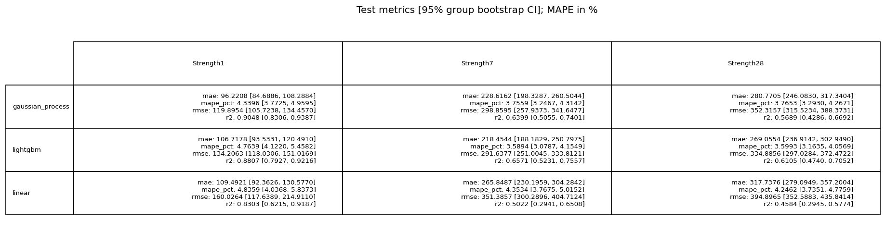

# Fase 4: evaluación única del lockbox

## Ficha y puerta adversarial

Estado: **ok**. Ejecución: 2026-11-04T02:38:45.955766+00:00 (UTC); commit `c75624b9fcbcd8501cd3653027441f49d38dda90`; run MLflow `ae3b0dd91e1947c585d8ff38cff2344e`; run padre `d90aa4d34750448b9b608383237660d5`. Protocolo: [ADR 0008](../adr/0008-protocolo-lockbox.md#enmienda-1).

El entrenamiento completo contiene 621 filas. Por targets faltantes, el test aporta 142, 150 y 141 filas para R1, R7 y R28, respectivamente, correspondientes a 140, 148 y 139 grupos. Los grupos de train y test son disjuntos.

La validación adversarial obtiene AUC 0.435 (umbral ≤ 0.6), 0 pares duplicados exactos y 1 par casi-duplicado (distancia ≤ 0.1). **La puerta pasa**; el casi-duplicado no es causal de parada.

## Desempeño global

Cada celda muestra estimación puntual [IC 95%], con 10 000 remuestreos bootstrap por grupo. MAPE está en porcentaje; MAE y RMSE están en las unidades originales de resistencia.

| Familia | Target | MAE [IC] | MAPE % [IC] | RMSE [IC] | R² [IC] |
|---|---|---:|---:|---:|---:|
| Lineal | R1 | 109.5 [92.4, 130.6] | 4.84 [4.04, 5.84] | 160.0 [117.6, 214.9] | 0.830 [0.621, 0.919] |
| Lineal | R7 | 265.8 [230.2, 304.3] | 4.35 [3.77, 5.02] | 351.4 [300.3, 404.7] | 0.502 [0.294, 0.651] |
| Lineal | R28 | 317.7 [279.1, 357.2] | 4.25 [3.74, 4.78] | 394.9 [352.6, 435.8] | 0.458 [0.294, 0.577] |
| LightGBM | R1 | 106.7 [93.5, 120.5] | 4.76 [4.12, 5.46] | 134.2 [118.0, 151.0] | 0.881 [0.793, 0.922] |
| LightGBM | R7 | 218.5 [188.2, 250.8] | 3.59 [3.08, 4.15] | 291.6 [251.0, 333.8] | 0.657 [0.523, 0.756] |
| LightGBM | R28 | 269.1 [236.9, 302.9] | 3.60 [3.16, 4.06] | 334.9 [297.0, 372.5] | 0.611 [0.474, 0.705] |
| GPR | R1 | 96.2 [84.7, 108.3] | 4.34 [3.77, 4.96] | 119.9 [105.7, 134.5] | 0.905 [0.831, 0.939] |
| GPR | R7 | 228.6 [198.3, 260.5] | 3.76 [3.25, 4.31] | 298.9 [257.9, 341.6] | 0.640 [0.506, 0.740] |
| GPR | R28 | 280.8 [246.1, 317.3] | 3.77 [3.29, 4.27] | 352.3 [315.5, 388.4] | 0.569 [0.429, 0.669] |

### Diferencia test − CV

Se compara con las medias de CV de la Fase 3; MAPE se expresa en puntos porcentuales. Una diferencia negativa en errores indica menor error en test.

| Familia | Target | ΔMAE | ΔMAPE (pp) | ΔRMSE | ΔR² |
|---|---|---:|---:|---:|---:|
| Lineal | R1 | -5.4 | -0.29 | -15.2 | +0.169 |
| Lineal | R7 | -6.0 | -0.19 | -11.7 | -0.033 |
| Lineal | R28 | -11.7 | -0.22 | -30.7 | -0.101 |
| LightGBM | R1 | -12.1 | -0.48 | -16.2 | +0.085 |
| LightGBM | R7 | -49.5 | -1.05 | -72.2 | +0.107 |
| LightGBM | R28 | -52.9 | -1.02 | -124.2 | +0.105 |
| GPR | R1 | -10.1 | -0.35 | -15.8 | +0.072 |
| GPR | R7 | -30.8 | -0.69 | -52.0 | +0.059 |
| GPR | R28 | -26.0 | -0.57 | -78.0 | +0.006 |

### Diferencia pareada frente a L1

ΔMAE = MAE del modelo − MAE de L1 sobre los mismos grupos; valores negativos favorecen al modelo. Las nueve combinaciones mejoran a L1 y sus IC 95% excluyen cero.

| Familia | Target | ΔMAE [IC 95%] |
|---|---|---:|
| Lineal | R1 | -50.9 [-75.2, -24.5] |
| Lineal | R7 | -30.2 [-56.1, -1.7] |
| Lineal | R28 | -90.3 [-130.7, -50.4] |
| LightGBM | R1 | -53.6 [-72.3, -35.2] |
| LightGBM | R7 | -77.5 [-105.8, -49.6] |
| LightGBM | R28 | -139.0 [-189.6, -88.6] |
| GPR | R1 | -64.1 [-84.1, -44.6] |
| GPR | R7 | -67.4 [-91.6, -43.3] |
| GPR | R28 | -127.3 [-175.6, -80.3] |

## Desempeño por tipo

R² se calcula dentro de cada tipo; no debe confundirse con el R² global. Types 2 y 3 tienen solo 8–12 filas por target: sus cifras no son fiables. Types 4 y 5 no aparecen en el lockbox.

| Familia | Target | Type 1: n, MAE, R² | Type 2: n, MAE, R² | Type 3: n, MAE, R² |
|---|---|---:|---:|---:|
| Lineal | R1 | 121, 106.9, 0.430 | 9, 134.0, -2.269 | 12, 116.8, 0.186 |
| Lineal | R7 | 129, 274.4, 0.160 | 9, 189.2, 0.350 | 12, 231.7, 0.202 |
| Lineal | R28 | 125, 331.0, 0.329 | 8, 214.9, 0.769 | 8, 213.4, 0.671 |
| LightGBM | R1 | 121, 105.6, 0.614 | 9, 101.0, -0.912 | 12, 121.9, 0.042 |
| LightGBM | R7 | 129, 222.1, 0.433 | 9, 172.0, 0.510 | 12, 214.4, 0.280 |
| LightGBM | R28 | 125, 269.9, 0.548 | 8, 233.9, 0.705 | 8, 291.5, 0.355 |
| GPR | R1 | 121, 95.7, 0.685 | 9, 59.8, 0.363 | 12, 128.4, 0.084 |
| GPR | R7 | 129, 234.7, 0.397 | 9, 181.6, 0.399 | 12, 197.9, 0.424 |
| GPR | R28 | 125, 288.0, 0.482 | 8, 225.7, 0.722 | 8, 222.3, 0.554 |

## Cobertura conformal CV+

Cobertura empírica por fila y ancho medio del intervalo en unidades de resistencia; cobertura nominal 90%. Las cifras de Types 2 y 3 no son fiables por su tamaño reducido (8–12 filas).

| Familia | Target | Todos: cobertura / ancho | Type 1: cobertura / ancho | Type 2: cobertura / ancho | Type 3: cobertura / ancho |
|---|---|---:|---:|---:|---:|
| Lineal | R1 | 93.7% / 451.8 | 95.0% / 450.4 | 77.8% / 464.5 | 91.7% / 455.8 |
| Lineal | R7 | 92.0% / 1146.6 | 90.7% / 1146.9 | 100.0% / 1143.7 | 100.0% / 1146.5 |
| Lineal | R28 | 94.3% / 1449.7 | 93.6% / 1449.5 | 100.0% / 1451.2 | 100.0% / 1451.1 |
| LightGBM | R1 | 97.2% / 494.1 | 97.5% / 491.5 | 100.0% / 530.6 | 91.7% / 492.2 |
| LightGBM | R7 | 93.3% / 1144.5 | 92.2% / 1142.5 | 100.0% / 1174.6 | 100.0% / 1143.9 |
| LightGBM | R28 | 98.6% / 1446.0 | 98.4% / 1441.9 | 100.0% / 1514.5 | 100.0% / 1441.1 |
| GPR | R1 | 94.4% / 450.3 | 94.2% / 449.8 | 100.0% / 456.6 | 91.7% / 451.1 |
| GPR | R7 | 94.7% / 1124.9 | 93.8% / 1123.6 | 100.0% / 1146.5 | 100.0% / 1123.3 |
| GPR | R28 | 93.6% / 1378.9 | 92.8% / 1378.0 | 100.0% / 1388.8 | 100.0% / 1381.9 |

LightGBM sobrecubre en R1 y R28 (97.2% y 98.6%), con intervalos conservadores; en R7 alcanza 93.3%. GPR alcanza 93.6–94.7% global. La cobertura por tipo fuera de Type 1 no puede sostenerse con estos tamaños.

## Monotonía

Tras la proyección isotónica, las tres familias alcanzan 100% de predicciones monótonas. Antes de proyectar, la familia lineal alcanza 99.3%; LightGBM y GPR alcanzan 100%.

## Interpretación y límites

El test muestra errores menores que la CV en casi todas las combinaciones. Dos causas plausibles son el ajuste final con todo el train (621 filas frente a aproximadamente 500 por fold) y la asignación aleatoria por grupo dentro del mismo periodo: el lockbox mide interpolación. Esto no constituye evidencia de fuga; la puerta adversarial pasó y los grupos son disjuntos. La CV temporal de GPR aumenta el MAE en +48/+152/+168 para R1/R7/R28 frente a la CV agrupada y sigue siendo la mejor guía disponible para desempeño futuro, con las salvedades de población y fechas descritas en [Fase 3](../fase3/modelado.md).

Se mantiene **GPR, arquitectura (a)**, campeón según la regla registrada en CV ([ADR 0006](../adr/0006-protocolo-cv-y-seleccion.md) y [ADR 0007](../adr/0007-arquitectura-multisalida-e-incertidumbre.md)). En test, LightGBM tiene menor MAE puntual en R7 (218 frente a 229) y R28 (269 frente a 281); los IC se traslapan. El lockbox no se usa para cambiar de modelo: esta es una observación sin consecuencias sobre la selección.

No se puede afirmar el desempeño en Types 4/5, el desempeño bajo deriva futura ni la cobertura por tipo fuera de Type 1.

## Siguientes pasos

En Fase 5, registrar en Unity Catalog el mismo modelo GPR ya evaluado y asignarle el alias `@champion`, sin reentrenar. Usar sus intervalos conformales en el simulador y comunicar sus límites de cobertura.
